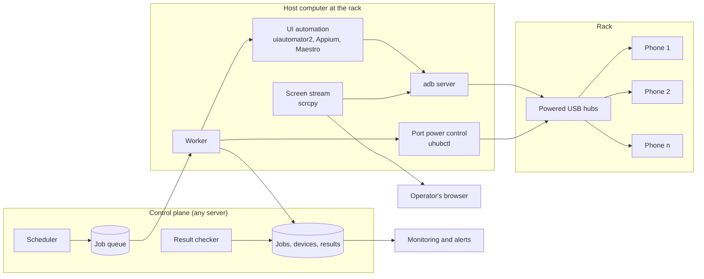

# Awesome Phone Farm

Open-source tools for running a phone farm: many real Android phones controlled from one computer. The tools are grouped by layer, and each has an honest one-line description, its licence, its stars and its last activity. A short setup guide and an architecture diagram come with the list.

Maintained by [EntireFeed](https://entirefeed.com), which runs phone farms for content distribution.

## What a phone farm is

A phone farm is a group of physical phones that are powered, connected and controlled together so that the same mobile task can run on many of them. Teams use one to test apps on real hardware, to check how content looks in native apps, and to publish to accounts they own and are allowed to run.

## What is in this list, and what is not

**In:** tools that connect to phones, show and control their screens, automate their apps, manage a fleet, schedule jobs and watch the health of the rack.

**Not in:** engagement bots, account creators, and tools whose job is to hide automation from a platform. Real phones do not change any platform's rules. Read the rules of the app you automate before you automate it.

## Contents

- [Architecture](#architecture)
- [Connect to the phones](#connect-to-the-phones)
- [See and control screens](#see-and-control-screens)
- [Automate the apps](#automate-the-apps)
- [AI agents that drive a phone](#ai-agents-that-drive-a-phone)
- [Manage the fleet](#manage-the-fleet)
- [iPhones](#iphones)
- [Power, USB and network](#power-usb-and-network)
- [Stream screens to a browser](#stream-screens-to-a-browser)
- [Queue and schedule jobs](#queue-and-schedule-jobs)
- [Monitor the rack](#monitor-the-rack)
- [When you do not need real phones](#when-you-do-not-need-real-phones)
- [Set up a small farm](#set-up-a-small-farm)
- [What breaks](#what-breaks)
- [Reading](#reading)
- [Contributing](#contributing)

## Architecture

A phone farm has the same five parts at 5 phones and at 500: a place where jobs wait, a host computer at the rack, the USB and power that reach each phone, a way for a person to see a screen, and a check that the work happened.

How one job moves through it is in [docs/architecture.md](docs/architecture.md).

## The list

Stars and last push were read from the GitHub API on **12 November 2026**. "Last push" is the date of the newest push to any branch. A licence marked with * is read from the repository's licence file, because GitHub does not report it as a standard licence.

What we have run ourselves: adb, scrcpy, uiautomator2, adbutils and WebRTC are part of our own farms. The other entries are described from their documentation and repository data. If a description is wrong, please open an issue.

### Connect to the phones

| Tool | What it does | Licence | Stars | Last push |
|---|---|---|---|---|
| [adb](https://developer.android.com/tools/adb) | Google's command-line bridge to an Android phone over USB or Wi-Fi. Everything else in this list sits on top of it. | Part of Android SDK Platform Tools | n/a | n/a |
| [openatx/adbutils](https://github.com/openatx/adbutils) | Python library that talks to the adb server, so scripts do not have to parse command output. | MIT | 1.1k | 2026-10-13 |
| [DeviceFarmer/adbkit](https://github.com/DeviceFarmer/adbkit) | The same idea for Node.js: a pure JavaScript adb client. | Apache-2.0* | 309 | 2026-11-07 |
| [yume-chan/ya-webadb](https://github.com/yume-chan/ya-webadb) | adb that runs in the browser over WebUSB. Useful for a control page with nothing to install. | MIT | 3.3k | 2026-11-06 |
| [mzlogin/awesome-adb](https://github.com/mzlogin/awesome-adb) | A long reference of adb commands. Written in Chinese, with an English file (`README.en.md`). | MIT | 12.5k | 2026-09-29 |

### See and control screens

| Tool | What it does | Licence | Stars | Last push |
|---|---|---|---|---|
| [Genymobile/scrcpy](https://github.com/Genymobile/scrcpy) | Shows a phone's screen on your computer and passes keyboard and mouse to it. No root, nothing left installed on the phone, Android 5.0 and later. The standard tool. | Apache-2.0 | 154.6k | 2026-11-10 |
| [barry-ran/QtScrcpy](https://github.com/barry-ran/QtScrcpy) | Desktop app built on the scrcpy approach with group control: one input sent to many phones. | Apache-2.0 | 32.8k | 2026-10-15 |
| [viarotel-org/escrcpy](https://github.com/viarotel-org/escrcpy) | A graphical front end for scrcpy, for people who do not want the command line. | Apache-2.0 | 12.4k | 2026-10-26 |
| [NetrisTV/ws-scrcpy](https://github.com/NetrisTV/ws-scrcpy) | scrcpy in a web browser. Its own description calls it a prototype. | MIT | 2.6k | 2026-10-31 |

### Automate the apps

| Tool | What it does | Licence | Stars | Last push |
|---|---|---|---|---|
| [openatx/uiautomator2](https://github.com/openatx/uiautomator2) | Python wrapper around Android's UI Automator. Finds elements by text or ID and taps, types and reads them. Android 4.4 and later, Python 3.8 and later. | MIT | 8.5k | 2026-11-03 |
| [appium/appium](https://github.com/appium/appium) | Cross-platform automation server that speaks the W3C WebDriver protocol. More setup than uiautomator2, and more languages and tooling. | Apache-2.0 | 22.2k | 2026-11-12 |
| [appium/appium-uiautomator2-driver](https://github.com/appium/appium-uiautomator2-driver) | The Appium driver you need for Android. | Apache-2.0 | 896 | 2026-11-11 |
| [mobile-dev-inc/Maestro](https://github.com/mobile-dev-inc/Maestro) | Flows written in YAML. Quick to write and read; built for testing one app, not for running a fleet. | Apache-2.0 | 16.4k | 2026-11-12 |
| [AirtestProject/Airtest](https://github.com/AirtestProject/Airtest) | Automation that matches images on the screen. The one to try for games and apps that expose no elements. | Apache-2.0 | 9.6k | 2026-03-23 |
| [google/mobly](https://github.com/google/mobly) | Google's Python test framework for tests that need several devices at once. | Apache-2.0 | 762 | 2026-11-11 |
| [codeskyblue/uiautodev](https://github.com/codeskyblue/uiautodev) | Shows a phone's UI tree in the browser and writes the XPath for an element. Use it to find selectors. | MIT | 543 | 2026-10-07 |
| [appium/appium-inspector](https://github.com/appium/appium-inspector) | The element inspector for Appium. Needs an Appium server running. | Apache-2.0 | 1.9k | 2026-11-12 |

### AI agents that drive a phone

These let a language model read the screen and choose the next tap. They are newer and less predictable than scripted automation, and each step costs a model call.

| Tool | What it does | Licence | Stars | Last push |
|---|---|---|---|---|
| [zai-org/Open-AutoGLM](https://github.com/zai-org/Open-AutoGLM) | An open phone-agent model and the framework to run it. | Apache-2.0 | 26.6k | 2026-03-06 |
| [mobile-next/mobile-mcp](https://github.com/mobile-next/mobile-mcp) | MCP server that gives an AI agent control of Android and iOS simulators, emulators and real devices. | Apache-2.0 | 10.5k | 2026-11-11 |
| [droidrun/mobilerun](https://github.com/droidrun/mobilerun) | Controls phones with natural-language commands and works with different model providers. | MIT | 10.0k | 2026-11-12 |
| [minitap-ai/mobile-use](https://github.com/minitap-ai/mobile-use) | Agent that operates real Android and iOS apps. | Apache-2.0 | 3.4k | 2026-11-11 |

### Manage the fleet

| Tool | What it does | Licence | Stars | Last push |
|---|---|---|---|---|
| [DeviceFarmer/stf](https://github.com/DeviceFarmer/stf) | Smartphone Test Farm. Lists your phones in a browser, lets a person reserve one and control it remotely. Its README lists support for Android 2.3.3 to 15 without root. | Apache-2.0* | 4.7k | 2026-11-12 |
| [shamanec/GADS](https://github.com/shamanec/GADS) | Device farm for remote control and Appium test runs on Android and iOS. Free to use, but the hub's web interface is proprietary and shipped obfuscated; the rest is AGPL-3.0. | AGPL-3.0 and proprietary | 415 | 2026-11-02 |
| [AppiumTestDistribution/appium-device-farm](https://github.com/AppiumTestDistribution/appium-device-farm) | Appium plugin that hands test sessions to whichever connected device is free. | Apache-2.0 | 660 | 2026-10-16 |
| [zebrunner/mcloud](https://github.com/zebrunner/mcloud) | Device farm for Android and iOS that is packaged to run in Docker. | Apache-2.0 | 206 | 2026-11-10 |
| [openatx/atxserver2](https://github.com/openatx/atxserver2) | Device management server from the uiautomator2 authors. Quiet since June 2026. | MIT | 1.4k | 2026-06-17 |
| [KnifeLemon/Droidline](https://github.com/KnifeLemon/Droidline) | Controls phones through an app installed on each phone instead of adb, so no cable or USB debugging is needed. Its README has a plain list of what it cannot do. Started in October 2026. | MIT | 523 | 2026-11-03 |
| [h-mdm/hmdm-server](https://github.com/h-mdm/hmdm-server) | Headwind MDM. Installs and updates apps and reads device information across many Android phones from a web panel. | Apache-2.0 | 570 | 2026-11-06 |

Archived, listed so you do not spend time on them: [SonicCloudOrg/sonic-server](https://github.com/SonicCloudOrg/sonic-server) (archived, last push 2025-03-24) and [agoda-com/android-farm](https://github.com/agoda-com/android-farm) (archived, last push 2020-05-03).

### iPhones

An iPhone farm is harder to run than an Android one, and you need Xcode on a Mac to sign WebDriverAgent. These are the building blocks.

| Tool | What it does | Licence | Stars | Last push |
|---|---|---|---|---|
| [appium/WebDriverAgent](https://github.com/appium/WebDriverAgent) | The WebDriver server that runs on the iPhone. Almost every iOS automation tool depends on it. | BSD* | 2.0k | 2026-10-29 |
| [meta/idb](https://github.com/meta/idb) | Command line for automating iOS simulators and devices. | MIT | 5.4k | 2026-11-11 |
| [danielpaulus/go-ios](https://github.com/danielpaulus/go-ios) | Talks to iPhones from Linux, Windows or macOS: install apps, start tests, read device information. | MIT | 2.3k | 2026-11-11 |
| [alibaba/tidevice](https://github.com/alibaba/tidevice) | Python tool for the same job. No push since November 2025. | MIT | 2.6k | 2025-11-21 |

### Power, USB and network

| Tool | What it does | Licence | Stars | Last push |
|---|---|---|---|---|
| [mvp/uhubctl](https://github.com/mvp/uhubctl) | Switches USB power on one hub port, so software can power-cycle one stuck phone. Works only with hubs that support per-port switching; the README lists them. | GPL-2.0* | 2.9k | 2026-07-25 |
| [Genymobile/gnirehtet](https://github.com/Genymobile/gnirehtet) | Reverse tethering: phones use the host's network connection through the USB cable. No push since August 2024. | Apache-2.0 | 8.1k | 2024-08-11 |
| [tailscale/tailscale](https://github.com/tailscale/tailscale) | Private network between your laptop and the rack's host, so you can reach the host without opening ports. | BSD-3-Clause | 39.0k | 2026-11-12 |

### Stream screens to a browser

scrcpy is enough for one person at the rack. To let several people watch phones from elsewhere, you put a stream on top.

| Tool | What it does | Licence | Stars | Last push |
|---|---|---|---|---|
| [livekit/livekit](https://github.com/livekit/livekit) | A complete WebRTC server with rooms and client libraries. | Apache-2.0 | 22.2k | 2026-11-12 |
| [pion/webrtc](https://github.com/pion/webrtc) | WebRTC in Go, for building your own stream. | MIT | 16.9k | 2026-11-12 |
| [webrtc-rs/webrtc](https://github.com/webrtc-rs/webrtc) | WebRTC in Rust. | Apache-2.0 | 5.2k | 2026-11-07 |

### Queue and schedule jobs

Nothing here is specific to phones. A farm needs a queue that survives a restart and can retry.

| Tool | What it does | Licence | Stars | Last push |
|---|---|---|---|---|
| [celery/celery](https://github.com/celery/celery) | Task queue for Python, with scheduled tasks. | BSD-3-Clause* | 29.2k | 2026-11-11 |
| [temporalio/temporal](https://github.com/temporalio/temporal) | Workflow engine for long jobs with many steps that must survive crashes. Heavier to run. | MIT | 24.4k | 2026-11-12 |
| [hibiken/asynq](https://github.com/hibiken/asynq) | Task queue for Go. | MIT | 13.8k | 2026-11-11 |
| [taskforcesh/bullmq](https://github.com/taskforcesh/bullmq) | Queue for Node.js and other languages. | MIT | 9.6k | 2026-11-12 |
| [riverqueue/river](https://github.com/riverqueue/river) | Job queue that keeps its jobs in Postgres or SQLite, so there is one less service to run. | MPL-2.0 | 5.9k | 2026-11-11 |

### Monitor the rack

| Tool | What it does | Licence | Stars | Last push |
|---|---|---|---|---|
| [prometheus/prometheus](https://github.com/prometheus/prometheus) | Collects numbers over time: phones online, battery temperature, jobs failed. | Apache-2.0 | 67.6k | 2026-11-11 |
| [grafana/grafana](https://github.com/grafana/grafana) | Dashboards and alerts on top of those numbers. | AGPL-3.0 | 77.9k | 2026-11-12 |
| [louislam/uptime-kuma](https://github.com/louislam/uptime-kuma) | Simple self-hosted "is it up" checks with notifications. Enough for a small rack. | MIT | 93.5k | 2026-11-12 |

### When you do not need real phones

If an emulator answers your question, it is cheaper than a rack and nobody has to visit it.

| Tool | What it does | Licence | Stars | Last push |
|---|---|---|---|---|
| [budtmo/docker-android](https://github.com/budtmo/docker-android) | Android emulator in Docker with a browser view. | Apache-2.0 with the author's own amendments* | 16.1k | 2026-11-10 |
| [remote-android/redroid-doc](https://github.com/remote-android/redroid-doc) | Android running in a container on a Linux server. | No licence file found | 7.1k | 2026-05-17 |
| [google/android-emulator-container-scripts](https://github.com/google/android-emulator-container-scripts) | Google's scripts for running the official emulator in a container. | Apache-2.0 | 2.1k | 2026-10-06 |

For occasional tests on real devices you can also rent them. [AWS Device Farm](https://aws.amazon.com/device-farm/pricing/) listed $0.17 per device minute on 12 November 2026.

## Set up a small farm

The short version. The commands are in [docs/setup-guide.md](docs/setup-guide.md).

1. Write down the one task the farm exists for, and what proves the task was done.
2. Make one phone do the whole task from the command line with adb.
3. Buy more of that exact model. Mixed models multiply the work.
4. Connect them through powered hubs that can switch power per port.
5. Give every phone a label and keep a table: label, serial, hub, port.
6. Script the task with a UI automation tool. Select elements by text or ID, not by position.
7. Put jobs on a queue. One job per phone at a time, and every reservation has a time limit.
8. Save evidence for every job, and check the result from outside the phone.
9. Record three outcomes: done, failed and unknown.
10. Add monitoring before you add phones.

## What breaks

The common failures and the command that finds each one are in [docs/troubleshooting.md](docs/troubleshooting.md). The short list: phones dropping off USB, adb showing `offline` or `unauthorized`, app updates that move buttons, system dialogs, hot phones, worn batteries, and jobs that died while holding a phone.

## Reading

- [The mobile device lab at the Prineville data center](https://engineering.fb.com/2016/07/13/android/the-mobile-device-lab-at-the-prineville-data-center/) (Meta, 2016). How Meta racked phones: eight Android devices per server, 32 phones per rack, one Wi-Fi access point for 64 phones, cameras pointed at the screens.
- [USB endpoints](https://knowledge.cambrionix.com/Content/Technical-Notes/Endpoints.htm) (Cambrionix). Why phones can stop appearing before the ports run out, with endpoint counts for some phones and hubs.
- [Android Debug Bridge](https://developer.android.com/tools/adb) (Android developers). The reference for adb.
- [Run apps on a hardware device](https://developer.android.com/studio/run/device) (Android developers). USB debugging and connection problems.
- [UI Automator](https://developer.android.com/training/testing/other-components/ui-automator) (Android developers). The framework under uiautomator2 and Appium's Android driver.
- [PhoneLab retrospective](https://arxiv.org/abs/1902.01929) (Shi, Santos and Challen, 2019). What a research team learned from running a testbed of real phones.
- [Pixel phone temperature guidance](https://support.google.com/pixelphone/answer/3333708?hl=en) (Google). What a phone does when it gets too hot: slower CPU, slower charging, radios off, then shutdown.

## Contributing

Additions and corrections are welcome. The rules are short and are in [docs/CONTRIBUTING.md](docs/CONTRIBUTING.md): the tool must be open source or free to read, it must fit the scope above, and the description must say what the tool does and where it falls short. That file also has the one command that refreshes the stars and dates.

## Licence

The list and the guides are released under [CC0 1.0](LICENSE). Use them however you like.

---

Maintained by EntireFeed. If you want a phone farm without building it yourself, we design and set up [custom phone farms](https://entirefeed.com/phone-farm).
