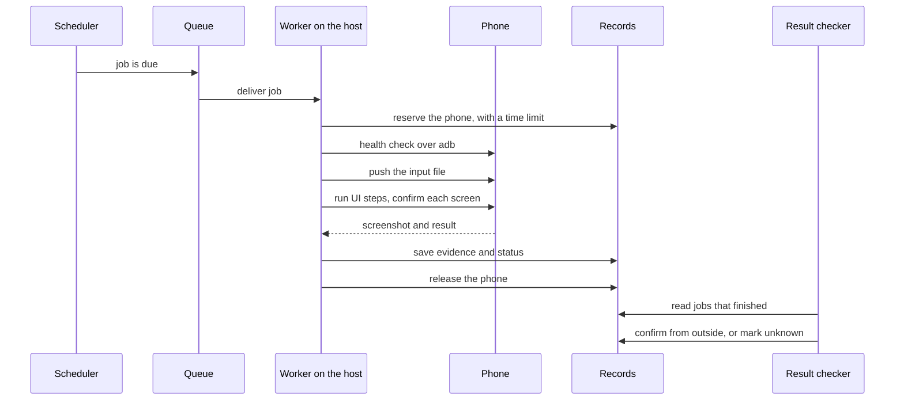
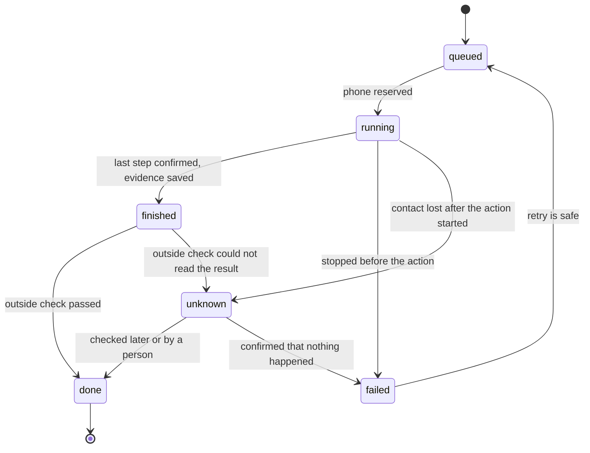

# Phone farm architecture

A phone farm is a job system with unusual workers. The workers are phones: they overheat, they lose their connection, and they show dialogs nobody asked for. The design below keeps those problems visible and stops them from turning into wrong results.

## The parts

| Part | Where it runs | Job | Tools from the list |
|---|---|---|---|
| Scheduler | Any server | Decides which job is due | Celery beat, Temporal, cron |
| Job queue | Any server | Holds jobs until a worker takes them, and retries | Celery, BullMQ, asynq, River |
| Records | Any server | Jobs, devices, reservations, results | Postgres or any database |
| Worker | Host at the rack | Takes a job, reserves a phone, runs the steps | Your code |
| adb server | Host at the rack | Carries every command to the phones | adb, adbutils, adbkit |
| UI automation | Host at the rack | Taps, types and reads the screen | uiautomator2, Appium, Maestro |
| Screen stream | Host at the rack | Lets a person see and control a phone | scrcpy, ws-scrcpy, WebRTC |
| Port power control | Host at the rack | Power-cycles one phone | uhubctl |
| Result checker | Any server, not the host | Confirms the result from outside the phone | Your code |
| Monitoring | Any server | Shows health and sends alerts | Prometheus, Grafana, Uptime Kuma |

Keep the result checker off the host. If the host or its network is the problem, a checker on the same machine has the same problem.

## How one job flows

## Job statuses

Two statuses are not enough. A job that lost contact halfway is neither done nor failed, and treating it as failed leads to a retry that does the action twice.

## Device states

`adb devices` says whether a phone is connected. It does not say whether the phone can work. Track these separately, because each one has a different fix:

| State | Meaning | How you know |
|---|---|---|
| Connected | adb can reach it | `adb -s SERIAL get-state` prints `device` |
| Healthy | Cool, charged, on the network, right app version | `dumpsys battery`, a network check, `dumpsys package` |
| Reserved | A job holds it | A reservation record that has not expired |
| Running | A job is acting on it now | The worker's heartbeat |

A phone that is connected and reserved while no job is running is a stranded reservation. On a dashboard it looks like a shortage of phones.

## Rules worth keeping

1. **One job per phone at a time.** Two scripts on one screen fight each other.
2. **Every reservation expires.** A crashed worker must not hold a phone forever.
3. **Confirm the screen before every action.** If the screen is not the expected one, stop and take a screenshot.
4. **Never retry an unknown job automatically.** Look at the result first.
5. **Keep a recovery path that does not depend on the thing that broke.** If the automation app on the phone crashes, plain adb still works. If adb stops answering, port power control still works. If that fails, someone goes to the rack, and you should know who.
6. **Record who or what did each step.** When a session drops, the next person should not have to guess what happened.

## Sizing

There is no universal number of phones per host. The limit is whichever runs out first: USB endpoints on the controller, host CPU if you stream many screens, power per hub, Wi-Fi throughput, or cooling. Meta's 2016 device lab connected eight Android devices to each server and held 32 phones in a rack ([source](https://engineering.fb.com/2016/07/13/android/the-mobile-device-lab-at-the-prineville-data-center/)). Use that as a yardstick, then measure your own phones under your own workload, all running at once.
